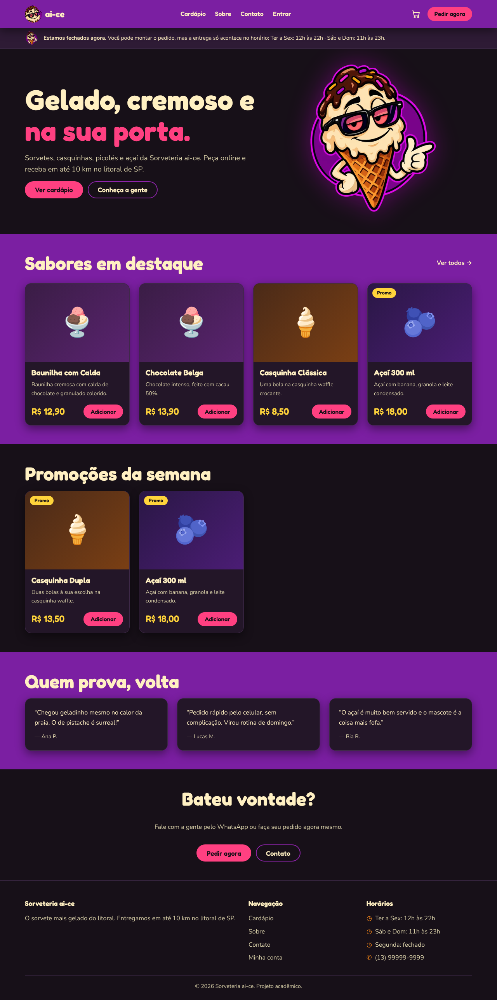

# 🍦 Sorveteria ai-ce

> Projeto acadêmico. Dados, produtos, endereço e imagens são **fictícios** — não representa uma sorveteria real.

Plataforma web de vendas de sorvetes: cardápio, carrinho, checkout, acompanhamento de pedidos e conta do usuário.

## Disciplina

- **Disciplina:** Desenvolvimento Web II
- **Professor:** Bruno Zolotareff dos Santos <!-- PENDENTE: titulação (ex.: Dr., Me.) — o autor preenche se souber -->
- **Integrante:** Miguel Rienzi Muniz

## O projeto

A sorveteria é um pequeno negócio fictício do litoral de São Paulo que hoje "vende só por WhatsApp". O sistema dá um canal de vendas online: o cliente vê o cardápio, monta o carrinho, finaliza o pedido com endereço e forma de pagamento (Pix, cartão ou dinheiro na entrega, todos simulados) e acompanha o status até a entrega — tudo pensado para uso no celular.

Escopo do MVP: cadastro e login simples (sem token — o backend confere e-mail/senha e devolve o usuário), cardápio público com filtro por categoria, carrinho, checkout com preço calculado no servidor, histórico de pedidos em "minha conta" e um formulário de contato.



## Links

- **Repositório:** https://github.com/migmunizz/sorveteria-ice
- **Aplicação:** não publicada — na apresentação, o sistema completo (frontend + backend + MySQL) roda localmente pelos comandos abaixo. *(Se o frontend for publicado na Vercel depois, o link entra aqui — ver `frontend/vercel.json`.)*

## Stack

| Camada | Tecnologia |
|---|---|
| Frontend | React 18 + TypeScript + Vite + React Router, CSS puro com variáveis |
| Backend | NestJS + TypeScript, arquitetura MVC |
| Banco de dados | MySQL 8, instalado direto no computador |
| Acesso ao banco | Prisma 6 (ORM) |
| Login | Simples: confere e-mail e senha (hash com `bcryptjs`), sem JWT |
| Validação | `class-validator` nos DTOs do NestJS |
| Pagamento | Simulado (Pix, cartão ou dinheiro na entrega) |
| Gestão | Scrum/Kanban no Trello (`docs/trello.md`) |
| Código | GitHub |

Detalhes de arquitetura, contrato da API e padrões de código: [`docs/arquitetura.md`](docs/arquitetura.md).

## Como rodar localmente (do zero)

### 1. Banco de dados (MySQL)

Precisa do MySQL instalado e rodando no computador (`sudo systemctl start mysqld` no Fedora). Depois, criar o banco e um usuário só para o projeto:

```sql
mysql -u root -p
CREATE DATABASE sorveteria;
CREATE USER 'sorveteria'@'localhost' IDENTIFIED BY 'sorveteria123';
GRANT ALL PRIVILEGES ON *.* TO 'sorveteria'@'localhost';
FLUSH PRIVILEGES;
EXIT;
```

(O `*.*` é necessário porque o Prisma cria um banco temporário ao gerar as migrações. Se usar outro usuário/senha, ajuste o `DATABASE_URL` no passo 3.)

### 2. Clonar e instalar

```bash
git clone https://github.com/migmunizz/sorveteria-ice.git
cd sorveteria-ice
npm --prefix backend install
npm --prefix frontend install
```

### 3. Variáveis de ambiente

Copiar os dois `.env.example` para `.env` (os valores padrão já combinam com o usuário criado no passo 1):

```bash
cp backend/.env.example backend/.env
cp frontend/.env.example frontend/.env
```

Em `frontend/.env`, preencher `VITE_API_URL=http://localhost:3000` (sem isso, o site roda só com dados mockados, sem precisar de backend nem banco).

### 4. Criar as tabelas e popular o cardápio

```bash
cd backend
npx prisma migrate dev
npx prisma db seed
cd ..
```

### 5. Ligar o backend e o frontend

```bash
npm run back      # http://localhost:3000 — terminal 1
npm run front     # http://localhost:5173 — terminal 2
```

Abrir `http://localhost:5173`. Para conferir o banco pelo navegador: `cd backend && npx prisma studio`.

### Rodar só o frontend (sem backend)

```bash
npm run front
```

Sem `VITE_API_URL` em `frontend/.env`, o site funciona inteiro com dados de exemplo (`frontend/src/mocks`) e salva usuário, carrinho e pedidos no `localStorage` — útil para apresentar sem precisar ligar o MySQL.

## Documentação

| Assunto | Onde |
|---|---|
| Arquitetura, stack, contrato da API, padrões de código | [`docs/arquitetura.md`](docs/arquitetura.md) |
| Plano de implementação (uma fase por arquivo) | [`docs/fases/README.md`](docs/fases/README.md) |
| Requisitos, casos de uso, diagrama de classes, modelo de dados, BPMN, MVC, padrões de projeto, decisões | [`docs/analise/`](docs/analise/) |
| Design System (cores, fontes, mascote) | [`docs/design-system.md`](docs/design-system.md) |
| Quadro Trello (sprints e cards) | [`docs/trello.md`](docs/trello.md) |
| Teste de usabilidade | [`docs/teste-usabilidade.md`](docs/teste-usabilidade.md) |
| Qualidade (Lighthouse) | [`docs/qualidade.md`](docs/qualidade.md) |
| Imagens do projeto (mascote, produtos, prints) | [`assets/README.md`](assets/README.md) |

## Estrutura

```
sorveteria-ice/
├── README.md
├── package.json            # atalhos: npm run front / npm run back / npm run front:build
├── frontend/                # React
├── backend/                 # NestJS + Prisma
├── assets/                  # imagens-fonte do projeto (ver assets/README.md)
└── docs/
    ├── arquitetura.md
    ├── fases/                # plano de implementação, uma fase por arquivo
    ├── analise/              # requisitos e diagramas
    ├── design-system.md
    ├── qualidade.md
    ├── teste-usabilidade.md
    └── trello.md
```

## Apresentação pessoal

<!-- PENDENTE (manual, texto do autor, estilo entrevista de emprego): -->

- O que te trouxe para a área de desenvolvimento web?
- Qual parte deste projeto você mais gostou de construir, e por quê?
- O que você faria diferente numa próxima versão?
