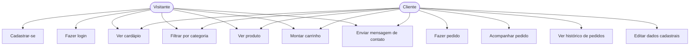

# Casos de uso

## Diagrama

> O **carrinho** vive só no navegador (não chama a API). Ele se torna um pedido de verdade quando o cliente faz o checkout (UC7).

## Tabela de casos de uso

| Caso de uso | Ator | Resumo |
|---|---|---|
| Cadastrar-se | Visitante | Cria uma conta com nome, e-mail, CPF, telefone e senha. |
| Fazer login | Visitante | Entra com e-mail e senha e recebe um token. |
| Ver cardápio | Visitante / Cliente | Lista os produtos disponíveis. |
| Filtrar por categoria | Visitante / Cliente | Mostra só os produtos de uma categoria. |
| Ver produto | Visitante / Cliente | Mostra os detalhes de um produto. |
| Montar carrinho | Visitante / Cliente | Adiciona e remove produtos de um carrinho local. |
| Fazer pedido | Cliente | Finaliza o carrinho em um pedido, com endereço e pagamento. |
| Acompanhar pedido | Cliente | Vê o status atual de um pedido específico. |
| Ver histórico de pedidos | Cliente | Lista os pedidos já feitos, do mais recente ao mais antigo. |
| Editar dados cadastrais | Cliente | Atualiza nome, telefone etc. em "minha conta". |
| Enviar mensagem de contato | Visitante / Cliente | Envia nome, e-mail e mensagem pelo formulário de contato. |

## Detalhamento: Fazer pedido

**Ator:** Cliente (precisa estar logado).
**Pré-condição:** o carrinho tem pelo menos um item.

### Fluxo principal

1. O cliente abre o carrinho e confere os itens.
2. O cliente clica em "finalizar pedido".
3. O sistema pede o endereço de entrega (rua, número, bairro, complemento opcional) e a forma de pagamento.
4. O cliente confirma.
5. O sistema recalcula os preços no backend, soma a taxa de entrega e cria o pedido com status `recebido`.
6. O sistema mostra a confirmação e limpa o carrinho.

### Fluxos alternativos

- **A1 — Carrinho vazio:** se o cliente tentar finalizar sem itens, o sistema mostra um aviso e não deixa continuar.
- **A2 — Não logado:** se o cliente não estiver logado, o sistema redireciona para a tela de login/cadastro antes do checkout; depois de logado, volta para o carrinho.
- **A3 — Endereço incompleto:** se faltar rua, número ou bairro, o sistema mostra o erro de validação no campo e não envia o pedido.
