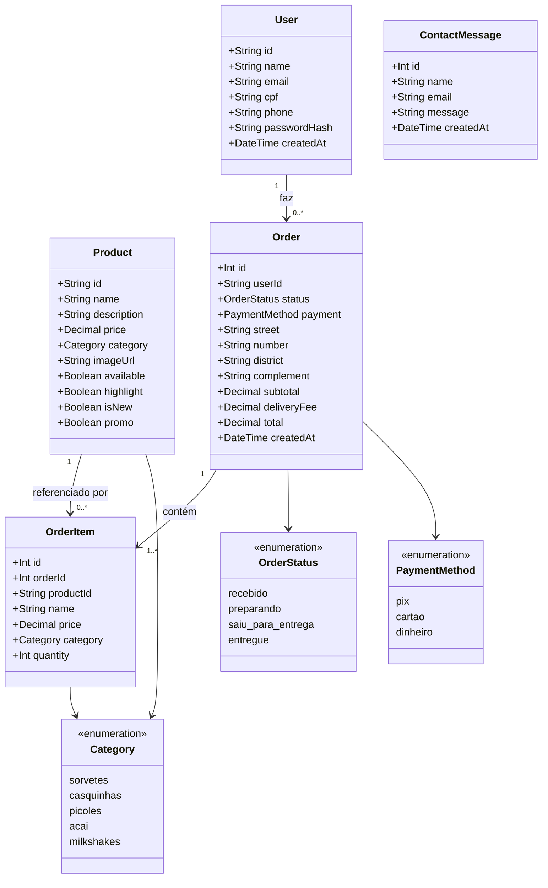
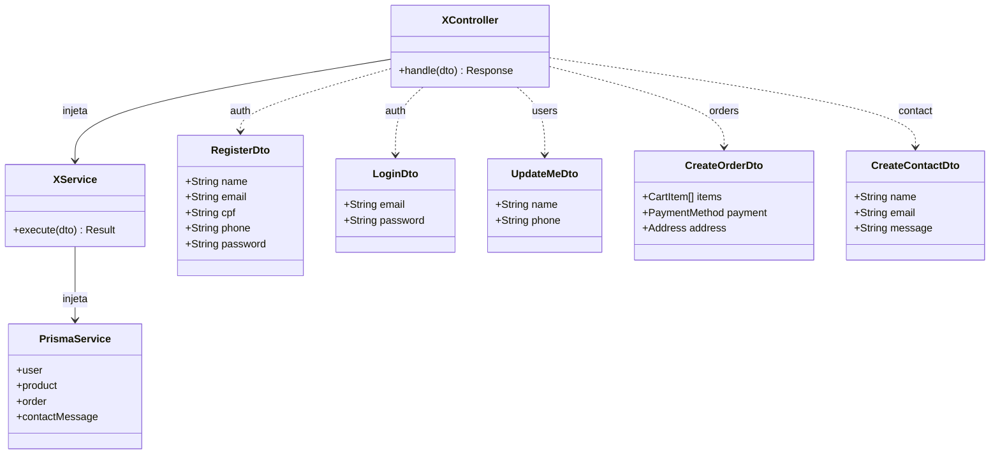

# Diagrama de classes

## Domínio

> `OrderItem` guarda uma cópia de `name`, `price` e `category` no momento da compra — se o produto mudar de preço depois, o pedido antigo não muda.

## Camadas MVC por módulo

Cada recurso (`auth`, `users`, `products`, `orders`, `contact`) segue o mesmo caminho: **Controller → Service → PrismaService**, usando DTOs para validar a entrada.

