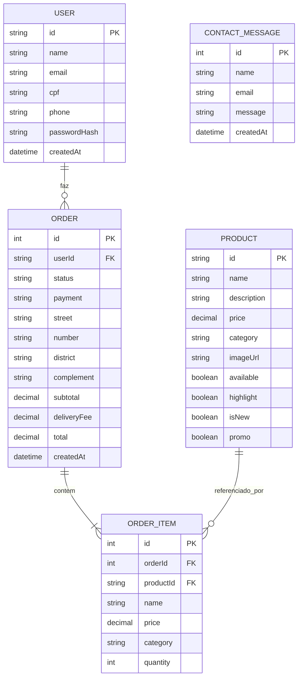

# Modelo de dados

Modelo relacional usado no `prisma/schema.prisma` (Fase 3), em MySQL.

## Tabelas

- **USER** — conta do cliente: dados cadastrais e a senha já em hash (`passwordHash`). `email` e `cpf` são únicos.
- **PRODUCT** — item do cardápio: nome, descrição, preço, categoria e as flags de destaque (`highlight`, `isNew`, `promo`) usadas na vitrine do frontend.
- **ORDER** — um pedido: status, forma de pagamento, endereço de entrega (campos soltos, sem tabela própria) e os valores calculados (`subtotal`, `deliveryFee`, `total`).
- **ORDER_ITEM** — um item dentro de um pedido: guarda `productId` mas também cópia de `name`, `price` e `category`, para o pedido não mudar se o produto for alterado depois.
- **CONTACT_MESSAGE** — uma mensagem enviada pelo formulário de contato, sem relação com as outras tabelas.

## Relacionamentos

- **USER → ORDER (1:N)** — um usuário pode ter vários pedidos; um pedido pertence a um único usuário.
- **ORDER → ORDER_ITEM (1:N)** — um pedido tem um ou mais itens; ao apagar o pedido, os itens são apagados em cascata (`onDelete: Cascade`).
- **PRODUCT → ORDER_ITEM (1:N)** — um produto pode aparecer em vários itens de pedidos diferentes; o item guarda uma referência ao produto original (`productId`).
