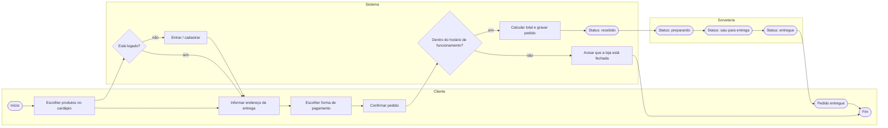

# Processo: Pedido de sorvete

## Observações

- A decisão **"está logado?"** aparece antes do endereço: visitante sem conta é mandado para login/cadastro e, depois de entrar, volta para o fluxo normal (caso de uso "Fazer pedido", fluxo alternativo A2 em `02-casos-de-uso.md`).
- A decisão **"dentro do horário de funcionamento?"** é checada depois da confirmação, antes de gravar o pedido; fora do horário o sistema avisa o cliente e não cria o pedido.
- Os três últimos status (`preparando`, `saiu_para_entrega`, `entregue`) são atualizados pela sorveteria (hoje, direto no banco via `prisma studio` — não há painel administrativo no MVP) e o cliente os acompanha na tela "meu pedido" (RF09).

> Se for exigida a notação BPMN oficial (eventos, gateways e piscinas no padrão BPMN 2.0), redesenhar este fluxo em https://demo.bpmn.io seguindo as mesmas raias e passos acima.
