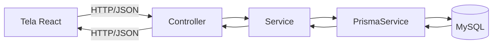

# Arquitetura MVC

## Caminho de uma requisição



O React nunca acessa o banco direto: toda leitura e escrita passa pela API NestJS, em formato JSON, seguindo o contrato de `frontend/src/types/index.ts`.

## Parte do MVC → arquivos do NestJS

| Parte do MVC | Arquivo | Responsabilidade |
|---|---|---|
| Model | `prisma/schema.prisma` | Define as tabelas e os relacionamentos. |
| Model | `*.service.ts` | Regra de negócio e acesso ao banco pelo `PrismaService`. |
| View | DTO de resposta (implícito no `return` do service) | Formato do JSON devolvido ao React. |
| Controller | `*.controller.ts` | Recebe a requisição, valida o DTO de entrada, chama o service e devolve a resposta. Sem regra de negócio. |

## Árvore de pastas (`backend/src`)

Estrutura alvo depois das Fases 3 a 6 — um módulo por recurso, cada um com `module`, `controller`, `service` e `dto/`:

```
backend/src/
├── main.ts
├── app.module.ts
├── health/
│   └── health.controller.ts
├── prisma/
│   ├── prisma.module.ts
│   └── prisma.service.ts
├── auth/
│   ├── auth.module.ts
│   ├── auth.controller.ts
│   ├── auth.service.ts
│   ├── auth.guard.ts
│   └── dto/
│       ├── register.dto.ts
│       └── login.dto.ts
├── users/
│   ├── users.module.ts
│   ├── users.controller.ts
│   ├── users.service.ts
│   └── dto/
│       └── update-me.dto.ts
├── products/
│   ├── products.module.ts
│   ├── products.controller.ts
│   └── products.service.ts
├── orders/
│   ├── orders.module.ts
│   ├── orders.controller.ts
│   ├── orders.service.ts
│   └── dto/
│       └── create-order.dto.ts
└── contact/
    ├── contact.module.ts
    ├── contact.controller.ts
    ├── contact.service.ts
    └── dto/
        └── create-contact.dto.ts
```
